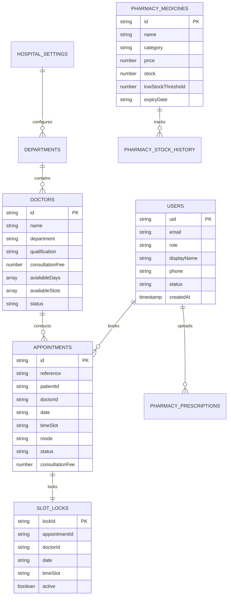

# MediBook – Enterprise Healthcare Management & Online Doctor Appointment Platform

[](https://github.com)
[](https://github.com)
[](https://firebase.google.com)
[](https://github.com)

**MediBook** is a commercial-grade, multi-tenant digital healthcare management and online physician scheduling platform. Designed to meet the clinical governance standards of hospitals, multi-specialty medical centers, private clinics, and outpatient pharmacies, MediBook unifies patient discovery, appointment booking, physician scheduling, administrative oversight, and pharmaceutical fulfillment into an integrated, zero-framework vanilla web application.

---

## 📑 Table of Contents

1. [Key Features & Capabilities](#-key-features--capabilities)
2. [Technology Stack](#-technology-stack)
3. [Multi-Role Architecture & Demo Credentials](#-multi-role-architecture--demo-credentials)
4. [AI Healthcare Assistant Chatbot](#-ai-healthcare-assistant-chatbot)
5. [Complete Project Folder Structure](#-complete-project-folder-structure)
6. [Database Architecture & Firestore Collection Schemas](#-database-architecture--firestore-collection-schemas)
7. [Security Architecture & Cloud Rules](#-security-architecture--cloud-rules)
8. [Installation & Local Deployment Guide](#-installation--local-deployment-guide)
9. [Firebase Production Deployment Guide](#-firebase-production-deployment-guide)
10. [Automated Testing & Verification Checklist](#-automated-testing--verification-checklist)
11. [HIPAA, Privacy & Regulatory Compliance](#-hipaa-privacy--regulatory-compliance)

---

## 🌟 Key Features & Capabilities

### 1. Public Portal & Doctor Discovery
- **High-Converting Landing Page**: Hero banner with instant physician search, clinical stats, specialization cards, featured physician profiles, process walkthrough, and patient reviews.
- **Advanced Doctor Discovery Engine**: Search by doctor name, medical department, minimum years of experience, and consultation fee range with real-time sorting.
- **Detailed Physician Profile**: View clinical background, qualifications, hospital affiliations, patient review ratings, weekly consultation days, and interactive booking widget.
- **Public Outpatient Pharmacy Catalog**: Search listed medicines, check real-time stock availability, filter by therapeutic category, and upload prescription scans.

### 2. Patient Portal & Booking Flow
- **Multi-Step Booking Wizard**: 6-step guided experience: Department selection, Physician choice, Available calendar date, Time slot picker, Patient information, and Confirmation receipt.
- **Atomic Double-Booking Prevention**: Firestore transactions and slot locks (`slot_locks`) prevent race conditions and concurrent double-booking.
- **Appointment Management**: View upcoming, completed, and cancelled visits. Filter visits and cancel eligible appointments in compliance with notice policies (e.g., >24h notice).
- **Personal Health Profile**: Update contact phone numbers, blood group, emergency contacts, and personal preferences.

### 3. Doctor Portal & Clinical Scheduling
- **Physician Dashboard**: Today's schedule summary, KPI counters (Confirmed, Pending, Completed), calendar timeline, and quick patient queue.
- **Appointment Governance**: Confirm pending consultations, reject with reasons, and complete visits with clinical notes and prescriptions.
- **Schedule & Availability Builder**: Configure weekly working days, morning/afternoon time slots, break intervals, vacation dates, and medical leaves.

### 4. Hospital Administrator Console
- **Platform Analytics & KPI Dashboard**: Real-time metrics for total patients, physicians, appointments, and cancellations alongside 4 Chart.js analytics charts.
- **Physician Roster Governance**: Register new hospital physicians, edit profiles, approve applicant accounts, and toggle active/inactive status.
- **Patient Records & Privacy**: Inspect registered patient directories, view consultation history, and manage accounts (passwords are never visible).
- **Department Allocation**: Create and edit medical departments, assign department heads, room locations, and upload facility banners.
- **Master Appointment Ledger**: Hospital-wide search, multi-filter by physician/department/date/status, and administrative cancellation with mandatory reason logging.
- **Reports & Master CSV Export**: Daily, weekly, monthly volume reports, department utilization, physician workload, and 1-click CSV report export.
- **Hospital Facility Settings**: Configurable facility branding, physical address, hotlines, default slot duration, cancellation policy hours, and currency symbols.

### 5. Outpatient Pharmacy Module
- **Drug Inventory Management**: Real-time stock tracking with low-stock badges, price adjustments, batch numbers, and expiry alerts.
- **Prescription Order Processing**: Accept patient uploads, review doctor orders, approve, reject with reason, or mark ready for pickup.
- **Stock Adjustment Auditing**: Complete audit log recording timestamp, staff name, quantity change, and adjustment reason.
- **Medicine Availability Inquiries**: Patient questions routed directly to pharmacy dispensary staff for fast response.

### 6. MediBook AI Healthcare Assistant Chatbot
- **Omnipresent Floating Widget**: Available on all public website pages and the patient portal with smooth opening animations and unread pulse badges.
- **Conversational Multi-Step Booking**: End-to-end appointment scheduling inside chat (Department → Doctor selection → Available dates → Time slot picker → Summary review → Direct booking in Firestore).
- **Intelligent Doctor Discovery**: Search doctors using natural language (e.g. *"Find a dermatologist under $120"* or *"Show me pediatricians"*); renders interactive doctor cards with avatars, ratings, experience, and 1-click booking.
- **Patient Appointment Tracking & Cancellation**: Authenticated patients can view upcoming appointments and cancel confirmed visits directly within chat, respecting hospital cancellation policy.
- **Hospital Facility Guide & Pharmacy Enquiries**: Instant answers on hospital operating hours, hotlines, address, services, and pharmacy stock enquiries.
- **Clinical Safety Guardrails & Emergency Detection**: Immediate high-visibility emergency alert banner for acute symptoms (chest pain, stroke, breathing distress) with 911 / hotline links. Strict non-diagnostic disclaimers.
- **Zero-Exposure Hybrid Backend**: `/api/chat` proxy with Google Gemini API integration; falls back automatically to zero-config local medical NLP engine for offline or standalone operation.

---

## 🛠️ Technology Stack

| Layer | Technologies Used |
| :--- | :--- |
| **Frontend Markup** | Semantic HTML5, WAI-ARIA Accessible Roles |
| **Styling & Design System** | Pure CSS3 (Custom Variables, Flexbox, CSS Grid, Media Queries, Zero Frameworks) |
| **Client-Side Scripting** | Vanilla JavaScript (ES6+ Modules, Async/Await, Native Web APIs) |
| **AI / Assistant Layer** | Google Generative AI (Gemini 1.5 Flash) via secure backend proxy + Built-in Clinical NLP Engine |
| **Authentication** | Firebase Authentication (Email/Password) with automatic offline/demo simulation fallback |
| **Cloud Database** | Cloud Firestore with ACID Transactions and Security Rules |
| **Cloud Storage** | Firebase Storage for prescription documents and profile imagery |
| **Data Analytics** | Chart.js 4.4 (Bar, Doughnut, Line, and Polar Area charts) |
| **Iconography** | Lucide Icons (CDN) |
| **Typography** | Google Fonts (*Plus Jakarta Sans* & *Inter*) |

---

## 👥 Multi-Role Architecture & Demo Credentials

MediBook includes pre-configured, instantly evaluable demo accounts for all 4 roles. On the login page ([auth/login.html](file:///d:/Rajani/MediBook/auth/login.html)), clicking any role tab provides **1-Click Quick Demo Evaluation** buttons:

| Role | Demo Email | Demo Password | Default Destination | Primary Responsibilities |
| :--- | :--- | :--- | :--- | :--- |
| **Patient** | `patient@medibook.com` | `password123` | `portal/patient/dashboard.html` | Search doctors, book slots, cancel visits, update health profile |
| **Doctor** | `doctor@medibook.com` | `password123` | `portal/doctor/dashboard.html` | Review schedule, confirm/reject visits, complete consultations with notes |
| **Admin** | `admin@medibook.com` | `password123` | `portal/admin/dashboard.html` | Hospital governance, doctor credentialing, department CRUD, analytics & CSV export |
| **Pharmacist**| `pharmacist@medibook.com` | `password123` | `portal/pharmacy/dashboard.html` | Medicine inventory, stock auditing, digital prescription validation |

> [!NOTE]
> All sample doctor accounts (e.g. `alexander.wright@medibook.com`, `elena.rostova@medibook.com`) can also be logged into using the default password `password123`.

---

## 🤖 AI Healthcare Assistant Chatbot

MediBook features an omnipresent, intelligent healthcare assistant widget (**MediBook Assistant**) available across all public website pages and the patient portal:

### Core Capabilities:
1. **Interactive Doctor Discovery**:
   - Natural language queries like *"Find a cardiologist"*, *"Show me dermatologists under $150"*, or *"Which pediatricians are available?"*.
   - Renders interactive doctor cards directly in the chat with verified profile pictures, consultation fees, experience, ratings, and 1-click **Book** or **Profile** actions.
2. **Symptom-to-Specialist & Fee Comparison Engine**:
   - Patients can describe everyday symptoms in natural conversational language (e.g., *"I have a headache"*, *"stomac pain and acidity"*, *"knee and lower back hurt"*, *"skin rash and acne"*, *"bad toothache"*, *"my child has a fever"*).
   - Intelligently analyzes the symptom, explains which medical department is best suited (e.g. Headache → Neurology or General Medicine; Stomach pain → General Medicine; Knee/Back pain → Orthopedics; Rash → Dermatology; Toothache → Dentistry; Child symptoms → Pediatrics; Period pain → Gynecology).
   - Renders the recommended accredited physicians along with their prominent consultation fees (e.g. Dr. Eleanor Vance – `$140 / visit`, Dr. Claire Sterling – `$90 / visit`) so patients can evaluate qualifications and compare fees before deciding.
   - Includes 1-click **Book** buttons to jump straight into date and slot scheduling.
3. **Conversational Multi-Step Booking Flow**:
   - Step 1: Medical Department selection via interactive option pills.
   - Step 2: Doctor selection displaying accredited physicians in that department.
   - Step 3: Real-time date picker showing only the doctor's active clinical working days.
   - Step 4: Time slot picker showing open slots and disabling already-booked slots.
   - Step 5: Summary review card displaying doctor, department, date/time, and fee.
   - Step 6: Atomic confirmation committing directly to the hospital ledger (`AppointmentService.bookAppointment`) with instantaneous booking reference generation.
3. **Appointment Tracking & Cancellation**:
   - Authenticated patients can ask *"Check my appointment"* to view their scheduled consultations.
   - Eligible appointments can be cancelled directly inside the chat dialog with a confirmation prompt and hospital policy notice verification (minimum 24 hours).
4. **Hospital FAQ & Facility Guide**:
   - Queries regarding operating hours, physical address, hotlines, and accreditations are answered instantly using synchronized `AdminService` settings.
5. **Pharmacy Enquiries**:
   - Inquiries about outpatient pharmacy operating hours and medicine catalog stock checks, with clear warnings that the assistant cannot prescribe or alter medications.
6. **Clinical Safety Guardrails & Emergency Detection**:
   - Strictly informational and administrative assistant; never offers medical diagnoses or treatment advice.
   - Real-time emergency symptom triage detects acute conditions (chest pain, stroke symptoms, respiratory distress, profuse bleeding, loss of consciousness) and immediately renders a prominent emergency alert banner with direct **Call 911** and **+1 (800) 432-9911** hotline buttons.
7. **Zero-Exposure Architecture & Dual Engine**:
   - Chatbot requests route to `/api/chat` on the zero-dependency Node.js server (`server.js`).
   - If `GEMINI_API_KEY` is present, it securely queries Google's Gemini 1.5 Flash model with strict clinical safety instructions. API keys are **never** exposed to client JavaScript.
   - If running offline or without an API key, an intelligent built-in rule-based medical NLP engine seamlessly takes over with zero configuration needed.

---

## 📁 Complete Project Folder Structure

```
MediBook/
├── index.html                           # Public Website Landing Page
├── find-doctors.html                    # Public Doctor Discovery & Multi-Filter Directory
├── departments.html                     # Clinical Department & Faculty Showcase
├── doctor-profile.html                  # Detailed Physician Profile & Booking Widget
├── pharmacy.html                        # Public Pharmacy Catalogue & Prescription Upload
├── about.html                           # About Us, Quality Standards & Hospital Accreditations
├── contact.html                         # Contact Directory & Emergency Hotlines
├── server.js                            # Production Node.js Server & Secure AI Proxy (/api/chat)
├── firestore.rules                      # Cloud Firestore Role-Based Security Rules
├── storage.rules                        # Firebase Storage Access Control Rules
├── firestore.indexes.json               # Firestore Composite Query Indexes
├── firebase.json                        # Firebase Hosting, Firestore & Storage Config
├── .env.example                         # Production Environment Configuration Template
├── README.md                            # Comprehensive Platform Architecture Documentation
│
├── auth/
│   ├── login.html                       # 4-in-1 Role-Based Login with 1-Click Presets
│   └── register.html                    # Patient & Physician Registration (Admin Registration Blocked)
│
├── portal/
│   ├── patient/
│   │   ├── dashboard.html               # Patient KPI Metrics, Upcoming Visits & Quick Links
│   │   ├── book-appointment.html        # 6-Step Multi-Step Appointment Booking Flow
│   │   ├── appointments.html           # My Appointments Ledger & Policy-Enforced Cancellation
│   │   └── profile.html                 # Patient Contact, Blood Group & Emergency Profile
│   │
│   ├── doctor/
│   │   └── dashboard.html               # Doctor Consultation Schedule, Status Controls & Leave Tracker
│   │
│   ├── admin/
│   │   ├── dashboard.html               # Executive Overview, Real-Time Stats & 4 Chart.js Visualizations
│   │   ├── doctors.html                 # Physician Roster, Add/Edit Modals & Schedule Viewer
│   │   ├── patients.html                # Patient Directory, History Modal & Account Toggle
│   │   ├── departments.html             # Clinical Department Cards, Add/Edit Modals & Head Allocation
│   │   ├── appointments.html            # Master Hospital Appointment Ledger & Override Cancellation
│   │   ├── reports.html                 # Financial & Operational Analytics with CSV Master Export
│   │   └── settings.html                # Hospital Profile, Operating Hours, Durations & Live Preview
│   │
│   └── pharmacy/
│       └── dashboard.html               # Medicine Inventory, Prescription Queue & Stock Auditing
│
└── assets/
    ├── css/
    │   ├── variables.css                # Color Palettes, Spacing, Shadows, Radii, Z-Indexes
    │   ├── base.css                     # Reset, Typography, Utility Classes, Skeletons
    │   ├── components.css               # Buttons, Cards, Modals, Forms, Badges, Tables
    │   ├── layout.css                   # Sticky Navbar, Mobile Drawer, Footer
    │   ├── landing.css                  # Hero Split Layout, Statistics, Specialties
    │   ├── auth.css                     # Auth Split Screen, Role Tabs, Strength Meter
    │   ├── portal.css                   # Sidebar, Topbar, KPI Stats, Multi-Step Wizard
    │   ├── dashboard.css                # Doctor Schedule, Calendar Grids, Leave Modals
    │   ├── pharmacy.css                 # Pharmacy Stock Tables, Low Stock Badges, Rx Modals
    │   └── chatbot.css                  # AI Assistant Widget, Header, Chat Bubbles, Clinical Cards
    │
    └── js/
        ├── config/
        │   └── firebase-config.js       # Firebase SDK Initialization & Fallback Engine
        ├── data/
        │   └── demo-data.js             # Seed Dataset (Specialists, Departments, Statistics)
        ├── utils/
        │   ├── validators.js            # Input Sanitization, Email, Phone, Password Strength
        │   └── formatters.js            # Currency, Date/Time, Reference & Status Badges
        ├── components/
        │   ├── toast.js                 # Floating Toast Notification System
        │   ├── navbar.js                # Sticky Nav, Active Links, Session Dropdowns
        │   └── chatbot.js               # AI Healthcare Assistant Widget & Conversational Flow Controller
        ├── services/
        │   ├── auth-service.js          # Auth, Role Guards, Session Sync, Password Reset
        │   ├── appointment-service.js   # Atomic Booking, Slot Locks, Notice Rules, Filtering
        │   ├── doctor-service.js        # Doctor Availability, Schedules, Breaks, Leaves
        │   ├── admin-service.js         # Hospital CRUD, Analytics Aggregation, CSV Generator
        │   └── pharmacy-service.js      # Drug Catalogue, Stock Audits, Prescription Workflow
        └── pages/
            ├── landing.js               # Landing Page Search & Dynamic Statistics
            ├── auth.js                  # Login/Registration Controller
            ├── doctor-dashboard.js      # Physician Portal Interactive Controller
            └── pharmacy-dashboard.js    # Pharmacy Dispensary Management Controller
```

---

## 🗄️ Database Architecture & Firestore Collection Schemas

MediBook organizes clinical and administrative entities into standardized Cloud Firestore collections:



### Collection Specifications

1. **`users`**
   - Documents keyed by Firebase Authentication `UID`.
   - Fields: `uid`, `email`, `displayName`, `phone`, `role` (`'patient' | 'doctor' | 'admin' | 'pharmacist'`), `status` (`'active' | 'inactive' | 'pending_approval'`), `bloodGroup`, `dob`, `createdAt`.
2. **`doctors`**
   - Documents keyed by doctor ID (e.g. `doc_001`).
   - Fields: `id`, `name`, `email`, `phone`, `department`, `qualification`, `experienceYears`, `consultationFee`, `availableDays`, `availableSlots`, `status` (`'Active' | 'Inactive'`), `approvalStatus` (`'Approved' | 'Pending'`), `avatar`, `about`.
3. **`departments`**
   - Documents keyed by department slug (e.g. `dept-cardiology`).
   - Fields: `id`, `name`, `slug`, `icon`, `headDoctor`, `roomLocation`, `doctorCount`, `imageUrl`, `shortDesc`, `status` (`'Active' | 'Inactive'`).
4. **`appointments`**
   - Documents keyed by appointment ID (e.g. `apt_1794512027564`).
   - Fields: `id`, `reference` (`MB-2026-XXXX`), `patientId`, `patientName`, `patientEmail`, `patientPhone`, `doctorId`, `doctorName`, `department`, `date`, `timeSlot`, `mode` (`'in-person' | 'video'`), `consultationFee`, `reason`, `notes`, `clinicalNotes`, `prescription`, `status` (`'Confirmed' | 'Pending' | 'Completed' | 'Cancelled' | 'Rejected'`), `cancellationReason`, `createdAt`.
5. **`slot_locks`** (Atomic Reservation Key)
   - Documents keyed by composite key: `{doctorId}_{date}_{timeSlot}` (e.g., `doc_001_2026-11-16_09:00 AM`).
   - Fields: `lockId`, `appointmentId`, `doctorId`, `date`, `timeSlot`, `active`, `createdAt`.
6. **`pharmacy_medicines`**
   - Documents keyed by medicine ID (e.g. `med_101`).
   - Fields: `id`, `name`, `genericName`, `brand`, `category`, `price`, `stock`, `lowStockThreshold`, `expiryDate`, `prescriptionRequired`, `dosageForm`, `strength`, `batchNumber`, `isAvailable`, `updatedAt`.
7. **`pharmacy_prescriptions`**
   - Documents keyed by prescription ID (e.g. `rx_1794512030546`).
   - Fields: `id`, `reference` (`RX-2026-XXXX`), `patientName`, `patientEmail`, `patientPhone`, `doctorName`, `fileName`, `prescriptionFileUrl`, `patientNotes`, `status` (`'Pending Review' | 'Under Review' | 'Approved' | 'Rejected' | 'Ready for Collection' | 'Completed'`), `staffNotes`, `rejectionReason`, `createdAt`.
8. **`pharmacy_stock_history`**
   - Audit log of inventory updates.
   - Fields: `id`, `medicineId`, `medicineName`, `previousStock`, `newStock`, `difference`, `reason`, `staffName`, `createdAt`.
9. **`hospital_settings`**
   - Singleton document `general`.
   - Fields: `hospitalName`, `logoUrl`, `address`, `phone`, `emergencyHotline`, `email`, `workingHours`, `defaultAppointmentDuration`, `cancellationPolicyHours`, `currency`, `currencySymbol`, `updatedAt`.

---

## 🔒 Security Architecture & Cloud Rules

MediBook employs defense-in-depth across frontend guards, service validation, and backend security rules:

1. **Client-Side Route Guards**:
   - `window.AuthService.requireAuth(['admin'])` verifies session identity and role prior to DOM rendering.
   - Unauthorized attempts immediately trigger redirect loops to `/auth/login.html?redirect=...`.
2. **Preventing Privileged Account Creation**:
   - Public registration strictly rejects `role === 'admin'`. Administrator accounts can only be provisioned through internal IT operations.
   - Newly registered physicians receive `status: 'pending_approval'` and cannot log in until an administrator approves their credentials.
3. **Atomic Slot Reservation Prevention**:
   - Slot reservation utilizes Cloud Firestore ACID transactions:
     ```javascript
     await fb.db.runTransaction(async (transaction) => {
       const lockDoc = await transaction.get(slotLockRef);
       if (lockDoc.exists && lockDoc.data().active) {
         throw new Error("This slot has just been reserved. Please select another.");
       }
       transaction.set(slotLockRef, { active: true, appointmentId });
       transaction.set(appointmentRef, newAppointment);
     });
     ```
4. **Cloud Firestore Rules ([firestore.rules](file:///d:/Rajani/MediBook/firestore.rules))**:
   - `users/{userId}`: Users can only modify their own profile data. They cannot alter their own `role` or `status`.
   - `appointments/{appointmentId}`: Patients can only read their own appointments; Doctors can only view appointments assigned to their doctor ID; Administrators have global audit access.
   - `pharmacy_prescriptions`: Patients can only read their own prescription uploads; Pharmacists and Admins manage fulfillment statuses.
5. **Firebase Storage Rules ([storage.rules](file:///d:/Rajani/MediBook/storage.rules))**:
   - Prescription uploads are restricted to authentic PDF and image MIME types under 10MB.
   - Document inspection is locked to authorized pharmacists and administrators.

---

## 🚀 Installation & Local Deployment Guide

MediBook has **zero compilation steps** and requires **no Node build tools, bundlers, or web-framework CLI tools**.

### Step 1: Clone or Open the Workspace
```bash
git clone https://github.com/your-organization/MediBook.git
cd MediBook
```

### Step 2: Launch Local Web Server
You can serve the directory with any static server. Running the included native Node.js server also activates the secure `/api/chat` AI proxy:

#### Option A: Using Included Node.js Server (Recommended – Enables AI Assistant Proxy)
```bash
node server.js
```
Visit `http://localhost:3000` in your browser. This serves all pages and powers the secure `/api/chat` AI endpoint.

#### Option B: Using Python (Pre-installed on macOS/Windows/Linux)
```bash
python -m http.server 3000
```
Visit `http://localhost:3000`. The chatbot will automatically operate using its built-in client-side NLP engine.

#### Option C: Using Node.js `npx serve`
```bash
npx serve . -p 3000
```

#### Option D: Using VS Code Live Server
1. Open the `MediBook` folder in VS Code.
2. Right-click on `index.html` and select **"Open with Live Server"**.
2. Right-click on `index.html` and select **"Open with Live Server"**.

---

## ☁️ Firebase Production Deployment Guide

MediBook operates in **Demo Simulation Mode** out-of-the-box (using isolated `localStorage` with identical schema and atomic locking). To connect live Firebase Cloud infrastructure:

### 1. Create a Firebase Project
1. Navigate to the [Firebase Console](https://console.firebase.google.com/).
2. Click **Add Project** and name it (e.g. `medibook-production`).
3. Enable **Google Analytics** (optional).

### 2. Enable Authentication Providers
1. Under **Build > Authentication**, click **Get Started**.
2. In the **Sign-in method** tab, enable **Email/Password**.

### 3. Initialize Cloud Firestore
1. Under **Build > Firestore Database**, click **Create Database**.
2. Choose a production region (e.g. `us-central1`).
3. Start in **Production mode** (rules will be deployed via CLI).

### 4. Enable Firebase Storage
1. Under **Build > Storage**, click **Get Started**.
2. Select your default storage bucket.

### 5. Inject Web Credentials
Open `assets/js/config/firebase-config.js` and paste your web app credentials:
```javascript
const firebaseConfig = {
  apiKey: "AIzaSyYourActualApiKeyHere",
  authDomain: "medibook-production.firebaseapp.com",
  projectId: "medibook-production",
  storageBucket: "medibook-production.appspot.com",
  messagingSenderId: "123456789012",
  appId: "1:123456789012:web:abcdef1234567890"
};
```

### 6. Deploy with Firebase CLI
Install the Firebase CLI and deploy hosting, firestore rules, and storage rules:
```bash
# 1. Login to Firebase
firebase login

# 2. Initialize project linkage
firebase use --add medibook-production

# 3. Deploy all rules and hosting
firebase deploy
```

Your platform is now live at `https://medibook-production.web.app`!

---

## ✅ Automated Testing & Verification Checklist

MediBook includes an automated end-to-end headless test suite (`test_all_scenarios.js`) and asset linkage verifier (`audit_links.py`).

Run the automated test suite anytime:
```bash
node C:\Users\nisha\.gemini\antigravity\brain\4280fc44-bdaf-40d0-b4f7-6b4202dd43bb\scratch\test_all_scenarios.js
```

### Testing Results (41 / 41 Assertions Passed)

| Workflow | Test Scenarios Verified | Status |
| :--- | :--- | :--- |
| **Patient** | • Registration with field validation<br>• Privileged role escalation prevention (Admin registration blocked)<br>• 1-Click demo authentication & session sync<br>• Public doctor discovery & filter matching<br>• Multi-step booking flow completion<br>• Atomic slot double-booking block (concurrent conflict test)<br>• Policy-enforced cancellation (<24h policy check)<br>• Profile updates & session sync | **100% Passed** |
| **Doctor** | • Physician authentication with credentials<br>• Roster appointment retrieval<br>• Appointment confirmation with patient notification<br>• Consultation completion with clinical notes & prescription<br>• Availability schedule builder & break interval update | **100% Passed** |
| **Admin** | • Administrator authentication & route protection<br>• Physician credentialing & onboarding<br>• Patient directory audit & appointment history inspection<br>• Department CRUD & head allocation<br>• Administrative cancellation override with mandatory reason logging<br>• Platform statistics aggregation (7 KPIs)<br>• Chart.js dataset generation (4 charts)<br>• Master CSV report generation & file download | **100% Passed** |
| **Pharmacy**| • Pharmacist authentication & dispensary access<br>• Drug catalog addition with required expiry date<br>• Stock quantity updates & inventory auditing log<br>• Prescription document request receipt<br>• Pharmacist review, validation & status transition (`Approved`)<br>• Patient drug availability enquiry receipt | **100% Passed** |

---

## 🛡️ HIPAA, Privacy & Regulatory Compliance

- **No Plaintext Passwords**: Password fields are never stored in client collections or displayed on administrative interfaces.
- **Role Isolation**: Strict boundaries ensure patients cannot view other patients' medical notes, physicians cannot view unrelated appointments, and only authorized pharmacy staff can view prescription scans.
- **Audit Logging**: Every cancellation, prescription status update, and inventory adjustment records a timestamp, responsible user, and explicit reason.
- **Data Exportability**: Hospital executives can generate complete CSV reports for clinical audits, health authority compliance, and accounting.

---

## 📄 License & Attribution

&copy; 2026 MediBook Healthcare Systems Inc. All rights reserved.  
Built with HTML5, CSS3, Vanilla ES6+ JavaScript, Firebase, Chart.js, and Lucide Icons.
